# Quy Trình Chuyển Đổi Figma → Bricks (Plan → Do → Done)

Tài liệu này mô tả quy trình thực thi khi nhận yêu cầu chuyển design Figma thành page + section templates trên site Bricks, chia theo 3 giai đoạn **PLAN** (phân tích & dựng khung) → **DO** (build từng template + review loop) → **DONE** (bàn giao).

> [!IMPORTANT]
> Luôn đọc file này, `rule_for_flow.md`, `work_info.md`, **`bricks-skills/MAPPING-FIGMA-FLOW.md`** (bản đồ tổng), và `review-skill/SKILL.md` (khi REVIEW) trước khi thực thi.

---

## 📚 Bản đồ tài liệu

| Giai đoạn | File chính | Vai trò |
|-----------|------------|---------|
| **Toàn flow** | `flow_figma_to_bricks.md` (file này) | PLAN → DO → DONE, MCP, scripts |
| **Rules** | `rule_for_flow.md` | Quy tắc bắt buộc (36 rules) |
| **Input** | `work_info.md` | Figma URL, tên page, template bỏ qua (tuỳ chọn), DONE |
| **Mapping** | `bricks-skills/MAPPING-FIGMA-FLOW.md` | Widget catalog ↔ flow ↔ gates |
| **Figma → widget** | `snippets/widget-map.md` | Chiến lược responsive theo **layout Figma** |
| **CSS workaround** | `snippets/css-custom.md` | `_cssCustom` khi Bricks không compile đủ |
| **Widget/settings** | `bricks-skills/references/elements.md`, `style-settings.md` | JSON shape verified Bricks 2.3.6 |
| **Plan mẫu** | `plans/_plan-template.md` | Schema section — copy thành `plans/<page>.md` |
| **Review** | `review-skill/SKILL.md`, `rubric.md` | G0–G4, ngưỡng ≥98% |
| **Scripts** | `scripts/README.md` | Lệnh G0–G3.5, autofix loop |

**Plan:** **một file** `plans/<page-slug>.md` / page (scripts đọc file này). Section phức tạp ghi đủ spec trong block `## Section`; annex tùy chọn `plans/<slug>/sections/<section>.md` — plan chính vẫn là nguồn G0.

---

## 🔁 Vòng lặp DO (Review / Rebuild)

Plan chi tiết + gate auto **không bỏ** vòng lặp — chỉ fail sớm và giảm số vòng G4.

```
[Template N — Desktop]
  BUILD → G1 (trước upload) → UPLOAD → G2 → G2.5 → G3 @1440
    ↓ fail G1–G3          → PATCH / rebuild → UPLOAD → lặp
    ↓ pass
  G4 visual vs Figma
    ↓ <98%                → PATCH layout (Figma MCP / plan) — KHÔNG --force-generic
    ↓ ≥98%
```

> **Desktop only** khi plan không có Figma Mobile URL — scripts tự skip mobile G3/G4.

```
[Template N — Mobile]  (chỉ khi có Figma Mobile URL trong plan)
  BUILD mobile → UPLOAD → G1→G3 @ bề rộng frame Figma mobile → G4
    ↓ fail                → PATCH (re-run G2 desktop nếu nghi ngờ)

→ Template N+1
```

| Gate | Tự động? | Tool |
|------|----------|------|
| G0 | ✅ | `validate_plan_g0.py` — trước BUILD |
| G1 | ✅ | `validate_template_json.py` — **trước** upload |
| G2 | ✅ | `validate_css_compiled.py` — sau upload |
| G2.5 | ✅ | `validate_section_structure.py` — strategy vs DOM |
| G3 / G3.5 | ✅ | `review_gates.py --per-section` — chụp PNG |
| **G4 auto** | ✅ | `g4_visual_gate.py` — pixel similarity ≥98% vs Figma PNG (tham số chuẩn) |
| **G4 checklist** | Agent + ✅ script | Agent điền `### G4 acceptance checklist`; `validate_g4_evidence.py --require-checklist` |

> **G4 pass = G4 auto pass + checklist pass** — định nghĩa duy nhất ở `rule_for_flow.md` § *Định nghĩa G4*. Rubric chỉ chẩn đoán.

```bash
# Sau mỗi upload — gate kỹ thuật tự động
python3 scripts/review_gates.py --plan plans/<page>.md --page-id <pid> --per-section

# Autofix + gate (tối đa N lần / section)
python3 scripts/section_autofix_loop.py --plan plans/<page>.md --page-id <pid>

# End-to-end autopilot — mặc định SINGLE-PASS: BUILD → G1–G3 → G4 auto 1 lần, không PATCH
python3 scripts/ldp_autopilot.py --plan plans/<page>.md --page-id <pid>
# Có PATCH tự động — tối đa 2 vòng / section (rule 39), PATCH làm điểm giảm → dừng
python3 scripts/ldp_autopilot.py --plan plans/<page>.md --page-id <pid> --until-pass
# alias: python3 scripts/g4_review_refix_loop.py --plan plans/<page>.md --page-id <pid>

# G4 visual auto (sau G3 + export Figma PNG)
python3 scripts/export_figma_section_pngs.py --plan plans/<page>.md
python3 scripts/g4_visual_gate.py --plan plans/<page>.md --write-diff

# G4 checklist (sau khi agent điền ✅ / ❌ vào plan)
python3 scripts/validate_g4_evidence.py --plan plans/<page>.md --require-checklist
```

**Chiến lược responsive — theo Figma mobile, không ép pattern:**

| Figma mobile | Strategy | G0 bắt widget mobile scroll/div? |
|--------------|----------|----------------------------------|
| Peek carousel (1 card + mép, swipe Splide) | `slider-responsive` | Không — cùng `slider-nested` |
| Scroll row thuần (không Splide) | `carousel-dual` | **Có** — `div`/`block` + scroll |
| Chỉ stack/co/size | `breakpoint-only` | Không |
| DOM/cấu trúc khác | `dual-block` | Không |

---

## 🧰 Bộ công cụ chuẩn (không dùng wp-cli)

| Việc | Công cụ | Lệnh mẫu |
|------|---------|----------|
| CRUD page/template | **Bricks MCP** (Cursor hoặc bridge) | `get_site_info`, `set_template_content`, `generate_css_file`, … |
| Phân tích Figma 1 section (PLAN nhanh) | skill **`figma-section-analyze`** | `python3 scripts/preflight_figma_bricks.py` → `python3 scripts/analyze_figma_section.py --desktop-url … --mobile-url … --slug …` |
| Resolve asset Figma (URL MCP từ xa) | `analyze_figma_section.py --assets` | `python3 scripts/analyze_figma_section.py … --assets <design_context.txt>` → `scripts/data/<slug>/assets.json` |
| Patch sau review (không rebuild full) | `scripts/patch_template.py` | `python3 scripts/patch_template.py <id> snippets/patches/<file>.json` |
| Kiểm tra asset đúng node (G1, tĩnh) | `scripts/validate_template_json.py` | `--json <out.json> --assets-json scripts/data/<slug>/assets.json` (tự động khi plan có `Asset map:`) |
| Screenshot review desktop | `scripts/screenshot_templates.py` | `python3 scripts/screenshot_templates.py --plan plans/<page>.md` |
| Screenshot review mobile | `scripts/screenshot_templates.py --width <frame Figma mobile> --suffix _mobile` | `python3 scripts/screenshot_templates.py --plan plans/<page>.md --width 375 --suffix _mobile` |
| **Widget catalog + settings Bricks** | **`bricks-skills/`** | `MAPPING-FIGMA-FLOW.md` → `references/elements.md`, `style-settings.md`, `patterns/` |
| Pattern CSS + Figma responsive | `snippets/css-custom.md`, `snippets/widget-map.md` | Chiến lược desktop/mobile + `_cssCustom` |
| Review gates G1/G2 (auto) | `scripts/review_gates.py` | `python3 scripts/review_gates.py --template-id <id> --page-id <pid>` |
| G1 JSON lint (trước upload) | `scripts/validate_template_json.py` | `--json` hoặc `--template-id` |
| G2 CSS compile (sau upload) | `scripts/validate_css_compiled.py` | `--template-id` + `--page-id` |
| Review visual G4 | **`review-skill/`** | `@review-skill` — chỉ sau G1–G3 pass |

**Review đăng nhập WP:** dùng **curl + cookie** (`.env`: `WP_URL`, `WP_USER`, `WP_PASS`) — xem `scripts/lib/wp_session.py`. **Không** dùng `wp-cli` (không ổn định trên môi trường hiện tại).

**MCP scripts (mọi IDE):** `.env` → `BRICKS_MCP_TOKEN` + `BRICKS_MCP_URL` — copy từ `.env.example`. Không bắt buộc Cursor hay `~/.cursor/mcp.json`.

**Mục tiêu chất lượng:** mỗi template hướng tới **100%** theo rubric REVIEW **ở cả Desktop và Mobile** (nếu `work_info.md` có Figma Mobile URL). **Ngưỡng pass tối thiểu: ≥ 98%** — dưới 98% phải PATCH và REVIEW lại trước khi chuyển template tiếp theo.

> [!CAUTION]
> **G1–G3 pass ≠ G4 pass.** Gate tự động không thay visual review. **Cấm** ghi DONE hoặc % G4 khi chưa hoàn thành checklist trong plan (xem `review-skill/SKILL.md` § G4 acceptance checklist).

### Anti-patterns (cấm lặp lại)

| Sai | Hậu quả | Đúng |
|-----|---------|------|
| Ghi G4 ≥98% sau G3 | User phải QA tay | Checklist plan + so Figma PNG ↔ Bricks PNG |
| PATCH liên tục không re-G4 | Layout lệch tích lũy | PATCH → G2 → G3 → G4 cùng viewport |
| Hỏi user “còn lệch không?” / dừng sau PLAN | Rối quy trình, build không xong | Agent tự so checklist, chạy hết template; chỉ dừng ở blocker cứng (rule 56). Riêng chế độ page có 1 PAUSE hỏi danh sách section sau PLAN |
| Sửa ngoài plan (thêm section/scope) | Lan man | Chỉ template trong plan + work_info |
| CSS/`splideJson` thử không kiểm layout | Desktop vỡ (vd. 1 cột) | Sau upload xác minh layout trước gate tiếp |
| Thêm rule Desktop + Mobile + Critical rules + PATCH CSS | Mâu thuẫn, tệ hơn bản đầu | Một snapshot + Mobile diff; sửa builder, không stack PATCH |
| Clone V1→V2 (`get_template` + `deepcopy`) | G4 pass ~98% nhưng layout kế thừa bug | Figma `get_design_context` + Settings snapshot; `validate_build_script.py` |
| `--force-generic` / autopilot loop khi G4 fail | Wipe cached tree → page trống | Giữ `data/*/trees/`; guard `tree_guard.py`; không rebuild on G4 fail |

**Responsive Bricks:** luôn **1 template / 1 section** — chọn **một** chiến lược/plan: `breakpoint-only` | `slider-responsive` | `dual-block` | `carousel-dual` | `n/a`. **Không** tạo 2 template section riêng cho desktop/mobile. Widget/settings: **`bricks-skills/MAPPING-FIGMA-FLOW.md`**.

| Breakpoint Bricks | Viewport review | Figma frame |
|-------------------|-----------------|-------------|
| Desktop (mặc định) | 1440px | Figma Desktop URL |
| `:tablet_portrait` | ≤991px | **Layout mobile Figma** (design không tách tablet — dùng cùng breakpoint cho dual-block / stack) |
| `:mobile_portrait` | ≤478px (chụp ở bề rộng frame Figma mobile) | Fine-tune thêm nếu cần |

---

## 🤖 Mục tiêu tự động hóa (Autopilot)

**Input:** Figma URL + tên page trong `work_info.md` → **Output:** page draft Bricks khớp Figma ≥98%, không QA tay từng section.

| Giai đoạn | Tự động? | Tool / ghi chú |
|-----------|----------|----------------|
| Phân tích Figma → plan | ✅ Script *(Phase C)* | `plan_from_figma.py --work-info work_info.md` |
| Tạo page + template shell | ✅ Script | `plan_from_figma.py --create-shell` |
| BUILD section JSON | ✅ Script | **`scripts/build_from_plan.py`** (Phase B — plan + cached trees) |
| G0–G3 gates | ✅ Script | `review_gates.py`, `section_autofix_loop.py` |
| **G4 auto** | ✅ Script | `export_figma_section_pngs.py` + `g4_visual_gate.py` |
| **G4 checklist** | Agent | Điền plan → `validate_g4_evidence.py --require-checklist` |
| PATCH khi G4 fail | Tuỳ chọn `--until-pass` | Tối đa 2 vòng / section (rule 39); điểm giảm → dừng, sửa builder phiên sau |
| **End-to-end** | ✅ Một lệnh | `ldp_autopilot.py` — mặc định single-pass: BUILD 1 lần → gates → G4 auto |

**Sau Phase C:** plan + shell auto; agent tự review tree/snapshot phức tạp. Chế độ page: PAUSE hỏi danh sách section (rule 56) rồi mới chạy autopilot; template-only: chạy ngay. Autopilot mặc định chạy hết section; section fail chỉ ghi blocker (`--stop-on-fail` để debug).

### Phase C — Auto PLAN (`scripts/plan_from_figma.py`)

```bash
python3 scripts/plan_from_figma.py --work-info work_info.md
python3 scripts/plan_from_figma.py --work-info work_info.md --create-shell
python3 scripts/ldp_autopilot.py --plan plans/page-<slug>.md --write-diff
```

| Output | Path |
|--------|------|
| Plan | `plans/page-<slug>.md` |
| Figma context | `scripts/data/<slug>/figma/{node}.json` |
| Page order | `snippets/page-<slug>-order.json` |
| work_info | Block *Thông tin sau phân tích* |

### Phase B — Generic builder (`scripts/lib/generic_builder/`)

**Mục tiêu:** một builder cho mọi page — không cần `build_ldp-template-v2-live.py` riêng.

```
plans/<page>.md
  ### Cấu trúc element   → tree_parser
  ### Settings snapshot → settings_parser
  ### Assets             → image URLs
        ↓
  scripts/data/<plan-slug>/trees/{template_id}.json  (optional full tree cache)
  scripts/data/<plan-slug>/figma/{node}.json         (optional Figma context export)
        ↓
  build_from_plan.py → Bricks JSON → MCP upload
```

| Lệnh | Vai trò |
|------|---------|
| `build_from_plan.py --all` | Build + upload mọi section trong plan |
| `--force-generic` | Bỏ cache — chỉ parse plan — **BLOCKED** nếu cache đầy hơn (`tree_guard.py`; cần `--confirm-overwrite-generic`) |
| `--dry-run` | Ghi JSON vào `scripts/refill/generic-*.json` |

**`.env` cần:** `WP_*`, `BRICKS_MCP_*`, `FIGMA_ACCESS_TOKEN` (export PNG G4).

---

## 📊 Sơ Đồ Quy Trình (Flowchart Phân Giai Đoạn)

```mermaid
flowchart TB
    %% ==========================================
    %% KHU VỰC PHÂN GIAI ĐOẠN (SUBGRAPHS)
    %% ==========================================

    subgraph PLAN ["📝 GIAI ĐOẠN: PLAN (Phân Tích & Dựng Khung)"]
        P1["1. Đọc work_info.md<br>(Figma URLs + Tên Page)"]:::plan
        P1_Dec{"Đủ thông tin?<br>Kết nối OK?"}:::decision
        P1_Ask["Báo user bổ sung<br>work_info.md"]:::plan
        P2["2. Phân tích Figma Desktop<br>(metadata → context → tokens)"]:::plan
        P2M["2b. Phân tích Figma Mobile<br>(metadata → diff từng section)"]:::plan
        P3["3. Ghi plans/ — desktop + mobile diff<br>widget map + chiến lược"]:::plan
        P4["4. Tạo Page theo tên (draft)"]:::plan
        P5["5. Tạo các Template (section)<br>theo tên section"]:::plan
        P6["6. Gắn templates vào page<br>+ đặt label theo tên section"]:::plan
    end

    SKIP["Lọc template theo work_info.md<br>'Thông tin sau phân tích' (nếu có)<br>— page: chờ user xác nhận sau PLAN"]:::plan

    subgraph DO ["🔨 GIAI ĐOẠN: DO (Desktop → Mobile, 1 template)"]
        D0["7a. Asset đúng node<br>spec.md: 0 chưa resolve"]:::do
        D1["7. Đọc work_info + plan"]:::do
        D2["8. BUILD Desktop"]:::do
        D3["9. UPLOAD"]:::do
        D4["10. REVIEW Desktop G1→G4<br>1440px"]:::do
        D4_Dec{"Desktop OK?"}:::decision
        D5["11. PATCH Desktop"]:::do
        D2M["12. BUILD Mobile<br>breakpoint / dual block"]:::do
        D3M["13. UPLOAD"]:::do
        D4M["14. REVIEW Mobile G1→G4<br>frame Figma mobile"]:::do
        D4M_Dec{"Mobile OK?"}:::decision
        D5M["15. PATCH Mobile"]:::do
        D6_Dec{"Còn template?"}:::decision
    end

    subgraph DONE ["✅ GIAI ĐOẠN: DONE (Bàn Giao)"]
        F1["16. Screenshot page desktop + mobile<br>+ asset check lần cuối"]:::done
        F2["17. Báo cáo: page url, edit_url<br>Desktop % | Mobile % từng section"]:::done
    end

    %% ==========================================
    %% KHAI BÁO STYLE MÀU SẮC
    %% ==========================================
    classDef plan fill:#E3F2FD,stroke:#1565C0,stroke-width:2px,color:#0D47A1;
    classDef pause fill:#FFEBEE,stroke:#C62828,stroke-width:2px,color:#B71C1C;
    classDef do fill:#FFF3E0,stroke:#EF6C00,stroke-width:2px,color:#E65100;
    classDef done fill:#E8F5E9,stroke:#2E7D32,stroke-width:2px,color:#1B5E20;
    classDef decision fill:#FFFDE7,stroke:#FBC02D,stroke-width:2px,color:#F57F17;

    %% ==========================================
    %% ĐƯỜNG ĐI LUỒNG CÔNG VIỆC (FLOW)
    %% ==========================================

    %% PLAN
    P1 --> P1_Dec
    P1_Dec -- Thiếu --> P1_Ask
    P1_Ask --> P1
    P1_Dec -- OK --> P2
    P2 --> P2M
    P2M --> P3
    P3 --> P4
    P4 --> P5
    P5 --> P6

    %% PLAN -> DO liền (rule 56)
    P6 --> SKIP
    SKIP --> D0

    %% DO: vòng lặp build từng template
    D0 --> D1
    D1 --> D2
    D2 --> D3
    D3 --> D4
    D4 --> D4_Dec
    D4_Dec -- "Chưa đạt" --> D5
    D5 --> D3
    D4_Dec -- "Đạt Desktop" --> D2M
    D2M --> D3M
    D3M --> D4M
    D4M --> D4M_Dec
    D4M_Dec -- "Chưa đạt" --> D5M
    D5M --> D3M
    D4M_Dec -- "Đạt cả 2" --> D6_Dec
    D4_Dec -- "Hết 2 vòng PATCH<br>ghi fail (rule 39, 56)" --> D6_Dec
    D4M_Dec -- "Hết 2 vòng PATCH<br>ghi fail (rule 39, 56)" --> D6_Dec
    D6_Dec -- "Còn" --> D2
    D6_Dec -- "Hết" --> F1

    %% DONE
    F1 --> F2
```



---

## 📝 GIAI ĐOẠN PLAN — Phân Tích & Dựng Khung

### Bước 1 — Đọc thông tin đầu vào

| Nguồn | Lấy gì |
|-------|--------|
| `work_info.md` | Figma Desktop URL · Figma Mobile/Breakpoint URL · Tên Page · (cuối phiên) mục **Đánh giá kết quả thực thi** |
| `rule_for_flow.md` | Các quy tắc bắt buộc |
| `bricks-skills/MAPPING-FIGMA-FLOW.md` | Widget catalog + mapping Figma → Bricks |
| `get_site_info` (bricks-mcp) | Xác nhận kết nối site; lỗi thì dừng và báo user |

> [!IMPORTANT]
> Thiếu thông tin nào trong `work_info.md` → dừng, báo user điền bổ sung. KHÔNG tự đoán.

### Bước 2 — Phân tích Figma (2 luồng, có thể làm liên tiếp trong PLAN)

#### 2a — Desktop (bắt buộc)

| Thứ tự | Tool | Mục đích |
|--------|------|----------|
| 1 | `get_metadata` | Frame Desktop — node id từng section |
| 2 | `get_design_context` | Chi tiết **từng section desktop** |
| 3 | `get_screenshot` | Chuẩn REVIEW desktop |
| 4 | `get_variable_defs` | Design tokens |

#### 2b — Mobile (bắt buộc nếu có Figma Mobile URL)

| Thứ tự | Tool | Mục đích |
|--------|------|----------|
| 1 | `get_metadata` | Frame Mobile (`3745:430` …) — map section tương ứng desktop |
| 2 | `get_design_context` | Chi tiết section mobile (chỉ section có **diff** hoặc toàn bộ lần đầu) |
| 3 | Ghi **diff** | So với desktop: layout/component/typography/spacing khác gì |

> [!IMPORTANT]
> **Image**: URL Figma MCP từ xa (`https://www.figma.com/api/mcp/asset/<uuid>/<file>`) resolve theo node id qua `analyze_figma_section.py` — dùng trực tiếp, **KHÔNG upload media**, không kiểm tra lại (rule 2).
>
> **PLAN = 2 luồng phân tích.** **DO = tuần tự Desktop → Mobile** trên **cùng 1 template Bricks** (`breakpoint-only` | `slider-responsive` | `dual-block` | `carousel-dual` | `n/a` — xem mục DO Mobile).

### Bước 3 — Ghi file phân tích vào `plans/`

**Một file** `plans/<page-slug>.md` — copy từ `plans/_plan-template.md`. Scripts (G0, review_gates, G1 asset map) đọc **file này**.

**Section đơn giản** (`breakpoint-only`): spec vừa đủ — strategy, widgets, Figma nodes, assets.

| Block | Nội dung |
|-------|----------|
| **Cấu trúc element** | Cây DOM (id semantic). `carousel-dual` / `dual-block`: hai nhánh trong cùng cây |
| **Measurements** | Số từ Figma desktop |
| **Mobile diff (@991px)** | Bullet chỉ thay đổi so desktop |
| **Settings snapshot** | Giá trị Bricks + `:tablet_portrait` — **nguồn sự thật** cho builder |
| **G4 acceptance checklist** | 1 dòng / bullet Mobile diff + layout desktop |
| **Pattern ref** | `bricks-skills/patterns/…` (tùy chọn) |

> **Không dùng:** `### Bricks widgets` Desktop/Mobile song song · `Critical rules` (rule 43). Mẫu: `plans/_plan-template.md`, `snippets/widget-map.md`.

Cấu trúc tối thiểu mỗi section:

```markdown
## Section 01 — <Tên section>
- Figma node desktop: `0:0`
- Figma node mobile: `0:0`
- Template ID: **0000**
- Chiến lược mobile: `breakpoint-only`
- Mobile diff: stack cột @991px

### Cấu trúc element
section → container → ...

### Settings snapshot
- gap 24 · padding 80px · `_direction:tablet_portrait: column`

### G4 acceptance checklist
| Tiêu chí | Pass |
| Layout desktop | |
| Mobile diff @991px | |
```

Cấu trúc page header:

```markdown
# Plan: <Tên Page>
- Figma Desktop: <url>
- Figma Mobile: <url>
- Page ID: **0000**
- G4 evidence dir: `notes/<slug>/assets/bricks`
```

> Map widget: `snippets/widget-map.md`. **G0:** `validate_plan_g0.py` — `--strict` bắt Settings snapshot, cấm plan legacy.

**`Mobile khác desktop?` — gợi ý chọn chiến lược:**

| Tình huống | Chiến lược |
|------------|------------|
| Chỉ đổi padding, flex-direction, font-size | `breakpoint-only` — settings `:mobile_portrait` |
| Đổi component / cấu trúc (grid → list, collage → 1 ảnh…) | `dual-block` — 2 khối con, ẩn/hiện theo breakpoint |
| Desktop **slider** (prev/next) + mobile **peek carousel** | `slider-responsive` — một `slider-nested` + breakpoint (`bricks-skills/patterns/sections/testimonials-slider.json`) |
| Desktop **slider** (prev/next) + mobile **scroll ngang thuần** | `carousel-dual` — `slider-nested` desktop + `div` scroll mobile |
| Không có Figma Mobile URL | `n/a` — vẫn áp dụng rule 10 tối thiểu (stack + padding) |

> [!TIP]
> File plan là nguồn dữ liệu duy nhất cho DO — ghi đủ desktop **và** mobile diff để không phải đọc lại Figma khi build mobile.

### Thứ tự section — Figma → Plan → Page → DO (rule 51–52)

**Nguồn sự thật:** `get_metadata` trên frame page desktop → frame con cấp 1, **sort theo `y` tăng dần**.

Ghi vào plan (và `work_info.md` sau PLAN):

| # | Figma name | Node | Template ID | DO |
|---|------------|------|-------------|-----|
| 1 | Hero section | `5:23442` | 8111 | build |
| 2 | Section 1 | `5:23710` | 8112 | build |
| … | … | … | … | … |

- **PLAN:** mỗi `## Section NN` đánh số **theo cột #** ở trên (không đặt tên lệch Figma, vd. plan “Section 04 Speakers” khi Figma là “Section 3”).
- **Page (`set_page_content`):** element `template` theo **cùng thứ tự #** — mẫu: `snippets/page-<slug>-order.json`.
- **DO:** `--all` / autofix loop duyệt section **theo #**, không theo template ID.

**LDP Template V2** (frame `5:23441`, Footer `14:16918` loại trừ): Hero → Section 1 → Bento → Speakers → Trusted → Compare → Partners → Events → Contact → **Floating Buttons** (cuối).

### Thứ tự phiên làm việc (rule 53)

Khi chất lượng chưa đạt Figma, **không nhảy thẳng rebuild**. Thứ tự bắt buộc:

1. **Rule / flow / validate** — chặn clone, materialize giả `figma`, G4 accountability
2. **PLAN** — metadata Figma + Settings snapshot + bảng thứ tự section
3. **DO** — builder Figma-live từng section theo #
4. **G4** — Figma PNG ↔ Bricks PNG, rubric từng hạng; user confirm visual
5. **DONE** — checklist plan + evidence; `Dọn dẹp` chỉ sau user hài lòng

### Bước 4 — Tạo Page

- Gọi `list_pages` kiểm tra trùng tên trước. Trùng thì tự tăng số thứ tự theo **rule 36**, KHÔNG ghi đè page cũ.
- `create_page` với **Tên Page** (đã chống trùng) từ `work_info.md`, status `draft`, chưa cần elements.
- Ghi `page_id` + tên thực tế đã dùng vào file plan.

### Bước 5 — Tạo các Template

- Gọi `list_templates` kiểm tra trùng tên trước; trùng thì xử lý theo **rule 36**.
- Mỗi section → 1 template: `create_template` với `type: "section"`, tên theo quy tắc `[Tên Page] - [Tên Section]` (**rule 35**, dùng tên page thực tế từ bước 4 — ví dụ page đổi thành `Page 2` thì template là `Page 2 - Hero`).
- Chưa cần `elements_json` (build ở giai đoạn DO).
- Ghi từng `template_id` vào file plan.

### Bước 6 — Gắn Templates vào Page + đặt Label

Ghi content page bằng `set_page_content`: mỗi section là 1 element `template` trỏ tới template tương ứng, **theo thứ tự # trong bảng Figma (rule 51)**, label đặt theo tên section:

> LDP Template V2 page **8110:** `snippets/page-ldp-template-v2-order.json`

```json
[
  {
    "id": "tpl001",
    "name": "template",
    "parent": 0,
    "children": [],
    "label": "Hero",
    "settings": {
      "template": 8001,
      "_label": "Hero"
    }
  },
  {
    "id": "tpl002",
    "name": "template",
    "parent": 0,
    "children": [],
    "label": "Features",
    "settings": {
      "template": 8002,
      "_label": "Features"
    }
  }
]
```

> [!IMPORTANT]
> Bricks Structure panel hiển thị tên từ field **`label` top-level** — `_label` trong `settings` alone không đủ. Mẫu: `snippets/page-template-label.json`.

---

## ⏸️ ĐIỂM DỪNG SAU PLAN — Hỏi danh sách section (chế độ page)

Hết bước 6 → **DỪNG một lần** (rule 56). Báo cho user:

1. `page_id`, `url`, `edit_url` (link clickable, rule 20)
2. Bảng section theo thứ tự Figma: `# | Figma name | node | template_id` + label đã gắn
3. Đường dẫn plan trong `plans/`

Hỏi: **template nào KHÔNG cần build layout?** (đã có sẵn, dùng lại, hoặc bỏ qua). User trả lời trong chat hoặc điền `work_info.md` → "Các template không cần build layout"; "build hết" = build tất cả. Có xác nhận → vào DO, bỏ qua template bị loại.

- Sau PAUSE **không hỏi lại** giữa các template; chỉ dừng ở **blocker cứng** của rule 56.
- **Template-only** (`Tên template:`): không PAUSE, PLAN → DO liền (rule 55).

> [!WARNING]
> Chế độ page: KHÔNG vào DO khi user chưa xác nhận danh sách section. Trong DO, section fail → ghi blocker, chạy tiếp; tổng kết ở DONE.

---

## 🔨 GIAI ĐOẠN DO — Build Từng Template (Desktop → Mobile)

> **Nguyên tắc:** Mỗi section = **1 template Bricks**. Với mỗi template: hoàn thành **Desktop ≥98%** (mục tiêu **100%**) rồi mới **Mobile ≥98%**, sau đó mới chuyển template tiếp theo.

### Bước 7a — Asset đúng node (đầu DO, bắt buộc)

URL asset là **Figma MCP từ xa**, không kiểm tra lại / refill sau build (rule 2) — nên phải đúng ngay trước BUILD:

1. `scripts/data/<slug>/spec.md` báo `Asset chưa resolve: **0**`, không còn dòng `⚠ asset lớp trong`.
   - Còn thiếu → `get_design_context` cho **đúng node** báo thiếu (mobile chỉ khi desktop không lan được) → chạy lại `analyze_figma_section.py … --assets <file>`.
2. Plan header có `- Asset map: \`scripts/data/<slug>/assets.json\``.
3. Builder lấy URL từ `spec.json` theo node id — **không** hằng số URL gõ tay. G1 fail nếu URL không thuộc asset map.

### Bước 7 — Chuẩn bị danh sách build

1. Đọc lại `work_info.md` → loại template không cần build layout.
2. Đọc `plans/` → desktop tree + cột **Mobile diff** + **Chiến lược mobile**.
3. **Script build mới** (rule 30, 48): phân tích Figma + widget map → viết `scripts/build_<page-slug>.py` mới hoặc build qua MCP. Không khôi phục script/refill/patch từ phiên trước hay agent transcript. **Không** clone template page khác (`get_template` foreign ID + `deepcopy`).
4. **G0.5** — trước UPLOAD section đầu tiên:

```bash
python3 scripts/validate_build_script.py --plan plans/<page-slug>.md
```

Fail → viết lại builder đọc Figma + `### Settings snapshot` (xem `scripts/lib/figma_build.py`).

### Bước 8–11 — Desktop (mỗi template)

| Bước | Việc | Chi tiết |
|------|------|----------|
| 8. BUILD | Layout desktop | `bricks-skills/references/elements.md` + `style-settings.md`; workaround: `snippets/css-custom.md` |
| 9. UPLOAD | `set_template_content` | Full JSON — REPLACE. Truyền **`sync_css: true`** (Python mặc định): external → generate file; inline → no-op |
| 10. REVIEW | Gates G1→G4 desktop | Xem bảng gates bên dưới |
| 11. PATCH | Sửa desktop | `patch_template.py` hoặc rebuild → **G1/G2 lại** |

**Autonomous loop (không chờ user screenshot):** mỗi section tự autofix → upload → G1/G2/G2.5 → chụp PNG → section tiếp:

```bash
python3 scripts/section_autofix_loop.py --plan plans/<page>.md --page-id <pid>
```

**Section template `pageSettings`:** mỗi lần upload section template, gửi kèm `page_settings_json` để ẩn site header/footer trên preview (screenshot G3 section-only):

```json
{"headerDisabled": true, "footerDisabled": true}
```

Python: `SECTION_REVIEW_PAGE_SETTINGS` trong `scripts/lib/bricks_mcp.py` — autofix loop áp dụng tự động.

**Review desktop (5 gates):**

| Gate | Khi | Lệnh |
|------|-----|------|
| G1 | **Trước** UPLOAD | `validate_template_json.py --json …` |
| G2 | **Sau** UPLOAD + `sync_css` | `validate_css_compiled.py --template-id … --page-id …` |
| G3 | Sau G2.5 pass | `review_gates.py --per-section` (1440px; `pageSettings`) |
| G4 | Sau G3 pass | `g4_visual_gate.py` ≥98% + checklist plan (`validate_g4_evidence.py --require-checklist`) |

```bash
python3 scripts/review_gates.py --template-id <id> --page-id <pid>
python3 scripts/screenshot_templates.py --page-id <page_id>
```

**G3/G4 trong DO:** `review_gates --per-section` chụp `tpl_*` (ẩn header/footer site). **G4** so Figma **section node**. **DONE (G3.5):** thêm `page_*` full page desktop + mobile.

### Bước 12–15 — Mobile (cùng template, sau khi Desktop ≥98%)

| Bước | Việc | Chi tiết |
|------|------|----------|
| 12. BUILD | Responsive mobile | Theo **Chiến lược mobile** trong plan |
| 13. UPLOAD | `set_template_content` | Full JSON (desktop + mobile settings/blocks). External CSS: `generate_css: true` hoặc `generate_css_file` |
| 14. REVIEW | Gates G1→G4 mobile @ bề rộng frame Figma mobile | Giống desktop; `--width <frame> --suffix _mobile` |
| 15. PATCH | Sửa mobile | Tránh phá desktop — PATCH xong **re-run G2 desktop** nếu cần |

**Bốn chiến lược responsive (cùng 1 template, chọn một / section):**

1. **`breakpoint-only`** — override settings Bricks:
   - `_direction:tablet_portrait`, `_padding:mobile_portrait`, `_typography:mobile_portrait`, …
   - Dùng khi mobile chỉ co/stack/đổi size (không đổi component).

2. **`slider-responsive`** — một **`slider-nested`**, desktop + mobile cùng DOM:
   - Desktop: `perPage: 3`, arrows/dots theo Figma
   - Mobile @991px: `perPage:tablet_portrait: 1`, card `_widthMax: 80%` (peek), ẩn arrows
   - Dùng khi mobile vẫn carousel swipe (vd. 「Sự kiện đã tham gia」)
   - Catalog: `bricks-skills/references/elements.md` § slider-nested · `patterns/sections/testimonials-slider.json`

3. **`dual-block`** — hai khối con trong section:
   - Block A (desktop): ẩn @991px
   - Block B (mobile): ẩn trên desktop
   - Dùng khi Figma mobile đổi component/cấu trúc (vd. grid card → list compact, collage → 1 ảnh)
   - Pattern: `snippets/css-custom.md` → **Dual block desktop/mobile**

4. **`carousel-dual`** — desktop slider + mobile scroll row thuần:
   - Block desktop: **`slider-nested`** + arrows
   - Block mobile: **`div`** row + `overflow-x:auto` (card `flex:0 0 286px`…)
   - Chỉ khi mobile **không** dùng Splide — xem `snippets/widget-map.md`

> [!WARNING]
> **Không** tạo template section thứ hai cho mobile. **Không** gắn 2 template trên page cho cùng 1 section — trừ khi user yêu cầu rõ.

**Review mobile:** `review_gates.py --screenshot --width <bề rộng frame Figma mobile> --suffix _mobile`. G4 so `page_<page_id>_mobile.png` vs Figma mobile node.

**Luồng quyết định (mỗi template × viewport):**

- ✅ G1 pass → upload được (hoặc đã upload + G2 pass)
- ✅ G1+G2+G3+G4 desktop pass → chuyển bước 12 (Mobile)
- ✅ G1+G2+G3+G4 mobile pass → template tiếp theo
- ❌ G1 fail → sửa JSON, **không upload**
- ❌ G2 fail → fix CSS/element type → UPLOAD → `review_gates.py` (G2)
- ❌ G3/G4 fail → PATCH → UPLOAD → **G2 → G3 → G4** (cùng viewport)
- ❌ Hết 2 vòng PATCH / điểm giảm → ghi fail vào plan + `work_info.md` → **template tiếp theo** (rule 39, 56), không hỏi user
- Ảnh sai node → `get_design_context` đúng node → `analyze_figma_section.py --assets` → rebuild → từ G1

**G4:** theo `rule_for_flow.md` § *Định nghĩa G4*. `review-skill/rubric.md` chỉ dùng chẩn đoán vùng lệch khi G4 fail.

> [!WARNING]
> `set_template_content` là **REPLACE toàn bộ** — mỗi lần upload phải gửi đầy đủ elements (desktop + mobile), không gửi mảnh.

---

## ⏹ Kết thúc phiên (trước DONE)

User **dừng phiên** hoặc chất lượng không đạt → **không** coi là DONE.

1. Cập nhật `work_info.md`: `Trạng thái DONE: chưa` · `Phiên: kết thúc` · thu hồi cột G4 pass chưa có checklist.
2. Ghi ngắn: section nào fail G4, số vòng PATCH, blocker (nếu có).
3. **Dừng** build/PATCH — phiên sau đọc lại plan + flow đã sửa; không nối tiếp PATCH cũ.

DONE chỉ khi **tất cả** section pass G4 desktop + mobile (rule 37–41).

---

## ✅ GIAI ĐOẠN DONE — Bàn Giao

**Điều kiện bắt buộc (đủ cả 4):**

1. Mỗi section pass G4 (`rule_for_flow.md` § *Định nghĩa G4*): G4 auto ≥98% desktop **và** mobile + checklist mọi dòng ✅.
2. User xác nhận visual trên page (rule 53).
3. `validate_g4_evidence.py --require-full-page --require-checklist` pass.
4. User **chưa** dừng phiên; `work_info.md` không ghi `Phiên: kết thúc`.

Sau đó:

```bash
python3 scripts/screenshot_templates.py --plan plans/<page-slug>.md
python3 scripts/screenshot_templates.py --plan plans/<page-slug>.md --width 375 --suffix _mobile  # = bề rộng frame Figma mobile
```

**External CSS:** sau khi bật Bricks → Settings → Performance → **External files**, mỗi template upload xong gọi MCP `generate_css_file` (1 file) — **không** cần `regenerate_css` toàn site trừ khi đổi global styles.
Báo cáo user **và cập nhật `work_info.md`** — bảng Review ghi **Desktop % | Mobile %** từng section **chỉ sau G4 checklist pass**.

| Mục báo cáo | Ai ghi | Nội dung |
|-------------|--------|----------|
| Page / Templates / Plan | Agent (chat + file) | `page_id`, bảng template, link edit |
| `Dọn dẹp` | Agent | Luôn đặt `chưa` sau báo cáo |
| `Plan file` | **Agent** | Đường dẫn plan vừa dùng, vd. `plans/page-cf-talk.md` |
| `Patch / wrapper một lần` | **Agent** | Liệt kê file patch/wrapper tạo trong phiên (hoặc `không` nếu không có) |

6. **DỪNG** — user kiểm tra page trên WP. Khi hài lòng → đổi `Dọn dẹp: có` → gửi lại `work_info.md` (không cần sửa `Plan file` / patch trừ khi muốn chỉnh danh sách xóa).

> [!IMPORTANT]
> Page giữ ở **`draft`** — chỉ publish khi user xác nhận rõ ràng.

### Bước 7 — Dọn dẹp (chỉ khi user gửi lại work_info.md)

**Điều kiện:** `work_info.md` → `Dọn dẹp: có` (user đã xác nhận kết thúc sau bước 5).

Lần thực thi sau sẽ tạo `plans/<page-moi>.md` mới — **không cần giữ** artifact lần cũ trong repo. Nội dung Bricks đã lưu trên WordPress.

**Xóa theo `Plan file` và danh sách patch/wrapper trong work_info:**

| Xóa | Ghi chú |
|-----|---------|
| `plans/<page-slug>.md` | Plan lần vừa xong |
| `screenshots/` (legacy) | PNG/HTML cũ nếu còn |
| `notes/<slug>/assets/bricks/tpl_*.png` | Evidence per-section (giữ hoặc xóa theo page mới) |
| `scripts/refill/*.json` | asset-check, refill-summary, `*-patched.json` |
| `snippets/patches/<patch>.json` | Patch một lần đã apply lên WP |
| `scripts/apply_*_fix.py` | Wrapper một lần (nếu có) |

**Giữ:** `scripts/` (tooling), `review-skill/`, **`bricks-skills/`**, `snippets/`, `flow_*.md`, `rule_for_flow.md`, `work_info.md`, `.env`.

```bash
rm -f plans/<page-slug>.md          # theo Plan file trong work_info.md
rm -rf screenshots/
rm -f scripts/refill/*.json
rm -f snippets/patches/<patch-one-off>.json   # nếu user liệt kê
```

Sau khi dọn xong: báo user danh sách file đã xóa; có thể reset `Dọn dẹp: chưa` và xóa/trống mục plan trong `work_info.md` cho lần thực thi mới.

> [!WARNING]
> **KHÔNG** tự ý dọn dẹp khi `Dọn dẹp: chưa` hoặc user chưa gửi lại `work_info.md`.

## 🧩 Chế độ template-only (rule 55)

**Kích hoạt:** chat có dòng `Tên template: <tên>` + Figma URL (`node-id`). Chỉ tạo template section, **không tạo page**.

```text
Tên template: Hero CF Talk
Figma Desktop URL: https://www.figma.com/design/<fileKey>/<name>?node-id=<id>
Figma Mobile URL: https://www.figma.com/design/<fileKey>/<name>?node-id=<id>   (tùy chọn)
```

| Bước flow page | Template-only |
|----------------|---------------|
| 1. Đọc input | Lấy từ chat, không cần `work_info.md` |
| 2–3. Phân tích Figma + plan | Giữ nguyên; plan `plans/template-<slug>.md`, header `- Mode: \`template-only\``, không có `Page ID` |
| 4. Tạo page | **Bỏ** |
| 5. Tạo template | Tên = đúng tên user ghi (nhiều section → `[Tên template] - [Tên section]`); trùng → rule 36 |
| 6. Gắn vào page | **Bỏ** |
| PAUSE | **Bỏ** — PLAN → DO liền dù 1 hay nhiều template (rule 56) |
| DO (G0–G4) | Giữ nguyên; G3/G4 so `tpl_*` với Figma node |
| DONE | `template_id`, `edit_url`, Desktop % \| Mobile %; không G3.5 full page |

```bash
# PLAN + tạo template rỗng (không page, không ghi work_info.md)
python3 scripts/plan_from_figma.py --figma-url "<url có node-id>" --template-name "<tên>" --create-shell
# link trỏ frame chứa nhiều section → thêm --multi-section

# DO từng template
python3 scripts/ldp_autopilot.py --plan plans/template-<slug>.md --template-id <id>
```

`plan_from_figma.py`, `validate_plan_g0.py`, `ldp_autopilot.py`, `section_autofix_loop.py` tự nhận `Mode: template-only` — không cần `--page-id`. Mặc định node trong link = **1 section** (không tách hàng con); chỉ dùng `--multi-section` khi `get_metadata` cho thấy node là frame chứa nhiều section. Evidence: `notes/template-<slug>/assets/bricks`.

---

## ⚠️ Xử Lý Lỗi Thường Gặp

| Lỗi | Cách xử lý |
|-----|------------|
| `bad_parent` / `bad_child` | Cây element lệch tham chiếu — sửa parent/children rồi `set_template_content` |
| `bad_json` | JSON sai cú pháp — validate file trong `scripts/refill/` trước khi upload |
| 401 MCP `mcp_unauthorized` | Kiểm tra `BRICKS_MCP_TOKEN` hoặc `MCP_CONFIG` trong `.env` → Bricks MCP Bridge settings |
| Ảnh sai / lệch node | `get_design_context` đúng node → `analyze_figma_section.py --assets <file>` (thêm `--reset-assets` nếu map cũ sai) → rebuild |
| G1 `Figma asset not bound` | Builder gõ tay URL — đổi sang lấy từ `spec.json` theo node id |
| G1 `localhost Figma asset` / `<asset:` | Plan cũ hoặc asset chưa resolve — resolve lại theo bước 7a |
| Screenshot trắng / guest redirect | Dùng `screenshot_templates.py` (curl login), không chụp URL trực tiếp không cookie |
| Hộp thoại "Google Chrome quit unexpectedly — Reopen" / lỗi `cannot run inside the Cursor sandbox` | Chrome bị sandbox agent chặn WindowServer → abort. Chạy `screenshot_templates.py` với `required_permissions: ["all"]` |
| Label hiện "Template" | Thêm `label` top-level trên page template elements |
| Style không áp dụng | Dùng `_cssCustom` / inline settings; `regenerate_css` optional |
| Template không render trên page | `settings.template` = đúng `template_id` |
| Mobile review thiếu | Chạy `--width <frame Figma mobile> --suffix _mobile`; so Figma Mobile node, không chỉ co desktop |

> **Không dùng:** `wp-cli`, truy vấn database thủ công, `wp-json/wp/v2/bricks_template` (404 trên site hiện tại).
